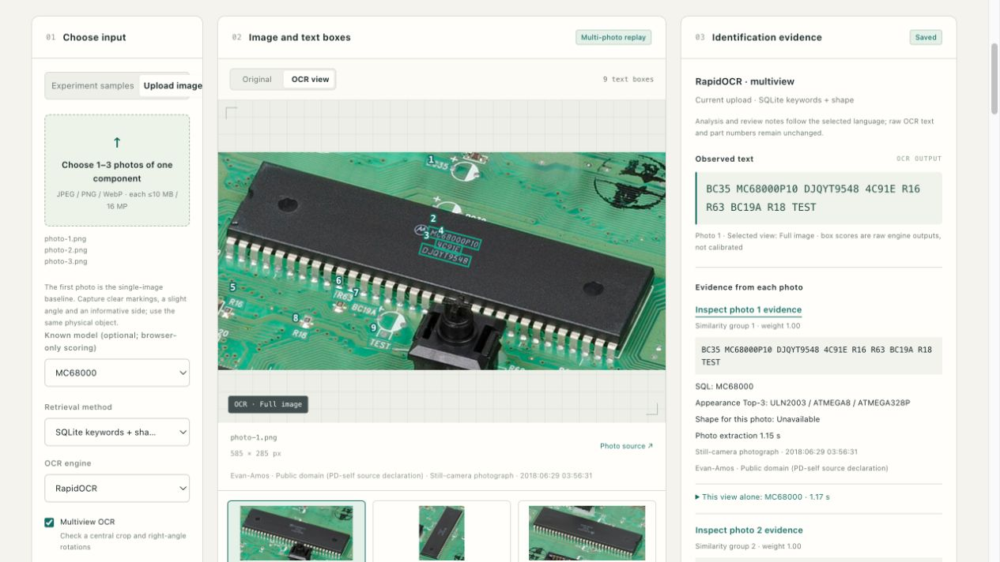
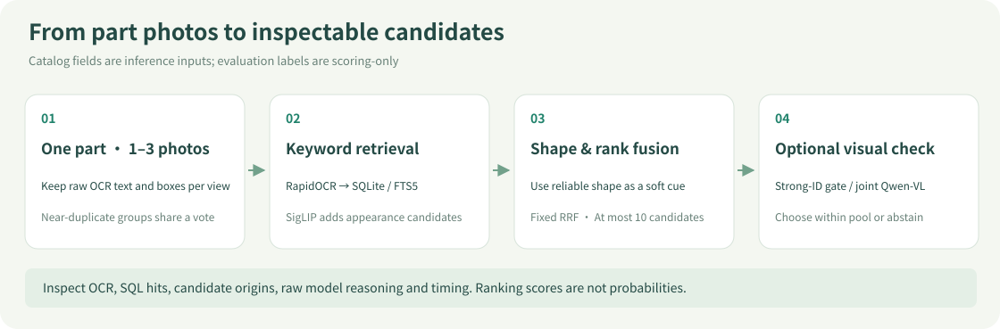
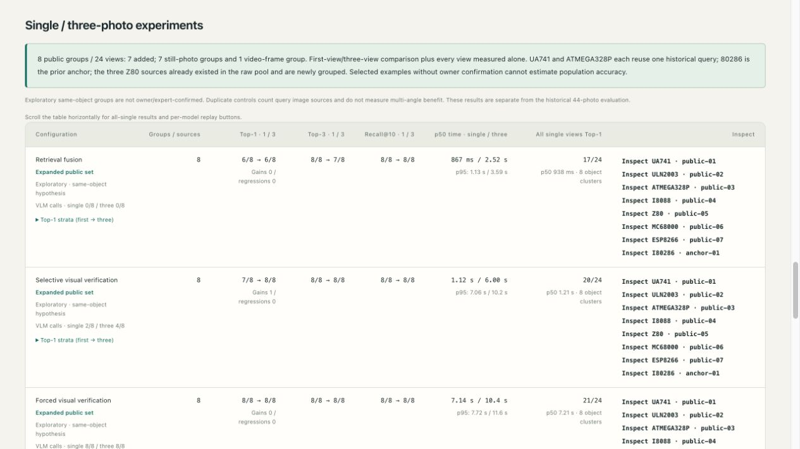
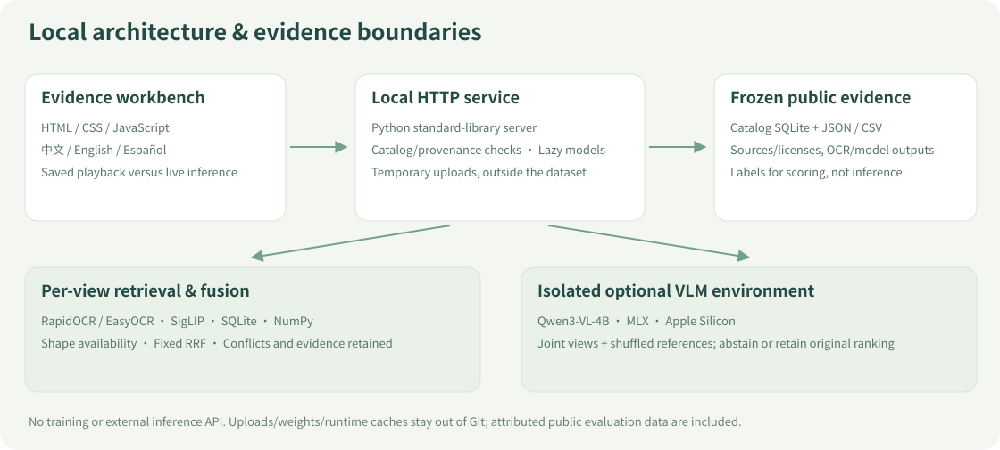

# PARTS / LAB · Part Identification Workbench

[中文](README.md) · **English** · [Documentation index](docs/README.md) · [Detailed experiments & reproduction](docs/EXPERIMENTS_AND_REPRODUCTION.en.md)

Identify catalog candidates from **1–3 photos of one component**. Use OCR keywords to retrieve records, then combine appearance, reliable shape cues and optional visual verification. Inspect raw text, matching fields, per-view evidence, reference images and timings.

A local research demo built with public photos and off-the-shelf models: **18 catalog classes, 44 historical queries, and 24 views of 8 hypothesized physical objects**. No training or fine-tuning. Predictions require review.



*Actual browser screenshot replaying saved public experiments, not new inference this turn. Photos: Evan-Amos, Public domain (PD-self source declaration). [Sources and figure notes](docs/assets/README.md).*

## Inspect playback, then run models

Requires Python **3.12** and [uv](https://docs.astral.sh/uv/). Node.js is only needed for browser behavior tests. Clone with a GitHub account authorized for this private repository.

```bash
git clone https://github.com/HenryVarro666/parts-retrieval-demo.git
cd parts-retrieval-demo
uv sync --frozen --extra experiments
uv run --frozen --extra experiments python -I -m partsid.web --port 8765
```

Open the [local workbench](http://127.0.0.1:8765/). Public evaluation photos, catalog SQLite, saved results and translation cache are included. **Playback needs no model-weight download**, although `uv sync` still installs project dependencies. Live inference downloads pinned models as needed. Weights, environments and runtime caches stay out of Git.

- **Experiment samples:** inspect the 44 queries, filter baseline errors and replay OCR/SQLite/visual conditions, including regressions.
- **Single / three-photo experiments:** inspect the 8 public groups; open a part and check each view's text, source and independent result.
- **Upload:** choose 1–3 photos of the same physical item, JPEG/PNG/WebP, each at most 10 MB / 16 MP. Live inference uses local temporary files and does not add uploads to evaluation data.
- **Languages:** Chinese / English / Spanish UI, model analyses and review notes. Raw OCR, identifiers, user content and measurements remain unchanged. Playback switching does not rerun models; first-time translation of a new live analysis may use the optional local VLM environment.

Default live flow: RapidOCR + SQLite + appearance supplements + shape. Visual verification is optional and requires the Apple Silicon environment below; unchecked means no VLM call. The optional known-label selector scores in the browser and **is never sent to inference**.

## How candidates are produced



| Evidence | Implemented use | Boundary |
|---|---|---|
| OCR | Whole image and central crop, each at four right-angle rotations; retain text and boxes | “Multi-view OCR” within one image differs from multiple photographs |
| SQLite / FTS5 | Exact/glyph-folded aliases first; trigrams tolerate partial errors; maker/description keywords | Log term, field and rule; empty/noisy OCR can return no candidates |
| SigLIP appearance | Supplement database candidates while retaining origin | SQL top five + image top five, deduplicated/filled to ten; image additions do not count as SQL hits |
| Shape | Elongation, solidity and circularity when foreground extraction is reliable | Unknown otherwise; no real dimensions, package identity or pin-count measurement |
| Multi-photo fusion | Fixed k=60 RRF, strong-ID protection and visible conflicts | Exact duplicates extracted once; near-duplicate groups share total vote weight; scores are uncalibrated |
| Optional Qwen-VL | Joint query views plus shuffled references, choose within pool or abstain | Reranking cannot select a missing class; explanations can misread evidence |

**Baseline Top-1** asks whether the original method's first candidate is correct. Top-3 / Recall@10 ask whether the correct class appears among its first 3 / 10 candidates. Catalog, RRF and OCR-box scores are not correctness probabilities.

## Saved results: 44 queries

The same historical development set, 18 classes, with model-generated labels and no component-expert acceptance. Rules and experiment design were examined against this data; these are not independent blind-test accuracy estimates.

| Method | Top-1 | Top-3 | Recall@10 |
|---|---:|---:|---:|
| Original EasyOCR three-channel baseline | 27/44 (61.4%) | 33/44 | 43/44 |
| RapidOCR, multiple views within each image | 38/44 (86.4%) | 40/44 | 42/44 |
| SQLite keywords only | 36/44 (81.8%) | 36/44 | 36/44 |
| SQLite + appearance supplements | 38/44 (86.4%) | 39/44 | 42/44 |
| Above + shape | 38/44 (86.4%) | 40/44 | 42/44 |
| New pool + visual check on every query | **42/44 (95.5%)** | 42/44 | 42/44 |
| Accept strong ID, otherwise visual check | 41/44 (93.2%) | 42/44 | 42/44 |

Shape was available on only **10/44** queries. Both remaining full-visual errors, UA741 and ULN2003, lack the correct Top-10 candidate. Gating adds one error versus full visual verification: an OCR error can match another valid alias. Earlier five-way equal voting reached 37/44, so more votes need not help. [Stage comparison](results/candidates/comparison.md) · [Earlier ensemble comparison](results/ensembles/comparison.md).

The 44-query visual timing is a sum of separately measured stages; the gate row is a fixed-policy projection. Neither is live end-to-end service latency. Forty-four new-pool VLM responses were actually generated; the final provenance-strengthened summary reused those 44 fingerprint-validated responses rather than generating them again. Historical timing scopes remain in the [detailed reproduction guide](docs/EXPERIMENTS_AND_REPRODUCTION.en.md).

## Saved results: first photo versus three



Eight selected object hypotheses: **7 still-photo groups + 1 video-view group**, without owner/expert identity confirmation. Twenty-four views are not 24 independent objects. The first view is predetermined, not selected for favorable recognition.

| Policy | Single Top-1 → three-photo Top-1 | p50 single → three |
|---|---|---|
| Retrieval fusion | 6/8 → 6/8 | 0.87 → 2.52 s |
| Selective visual verification | 7/8 → 8/8 | 1.12 → 6.00 s |
| Forced visual verification | 8/8 → 8/8 | 7.14 → 10.37 s |

Adding photos alone did not improve Top-1; retrieval Top-3 fell from 8/8 to 7/8. Selective verification corrected one ATmega error, while forced single-photo verification already reached 8/8. All 24 views individually scored 17/24, 20/24 and 21/24; interpret them as clustered within 8 objects.

Both paired paths freshly extract query evidence, share initialized retrieval models, and run the single-photo path first. Times include requested VLM processes/loading and exclude retrieval initialization, queueing and webpage translation. Measured on M4 Pro; order/cache effects remain, and results do not establish RTX 5080 performance.

Of the 24 source captures, 16 were outside the original 209 records and 8 reused sources, including two historical queries and the 80286 anchor. No generated angles. Targets were manually cropped; whole-board component localization was not evaluated. [Results and limits](docs/research/2026-10-31-public-triplets-results.md) · [Per-photo sources/licenses](data/public_triplets/README.md) · [Usage guide](docs/MULTI_IMAGE_GUIDE.md).

## Architecture and optional model environment



`partsid/web.py` serves a local standard-library HTTP workbench. The original baseline retains identifier matching, BGE text embeddings, SigLIP image embeddings and RRF. The newer SQLite path is evaluated separately. Image-vector search uses NumPy, not a vector database. JSON/CSV and fingerprinted caches retain multi-photo evidence, provenance and translations.

Optional model: `mlx-community/Qwen3-VL-4B-Instruct-4bit`, isolated from the baseline environment. The implemented local execution route targets **macOS Apple Silicon**:

```bash
uv venv .venv-vlm --python 3.12
uv pip install --python .venv-vlm/bin/python -r experiments/vlm-lock.txt
# For live uploads, enable visual verification when evidence is insufficient.
```

Playback needs no VLM environment. Linux/Windows can replay saved judgments; that does not make MLX execution CUDA-compatible. PyTorch uses a cu132 index on Linux/Windows, but RTX 5080 execution is unverified. Mac measurements do not establish GPU acceptance. See [detailed experiments and reproduction](docs/EXPERIMENTS_AND_REPRODUCTION.en.md) for pinned revisions, caches and rerun commands.

## Verify and continue

```bash
uv run --frozen --extra experiments pytest -q
uv run --frozen --extra experiments ruff check partsid tests scripts
node --test tests/web_i18n.test.cjs tests/web_multi_image.test.cjs tests/web_app_multi.test.cjs
python3 scripts/readme_figures.py --check
```

GitHub Actions runs the same checks on every push (CPU PyTorch) and rebuilds the paired report to confirm `results/` is unchanged. The local server listens on 127.0.0.1 only and has no authentication; `--host` on any other address prints a warning and must sit behind an authenticating reverse proxy, and browser host names need `--allowed-host`. The 2026-11-04 service hardening and review findings are in the [record (Chinese)](docs/research/2026-11-04-production-hardening.md).

[Previous complete verification](docs/research/2026-10-31-public-triplets-verification.md) passed 178 Python + 16 Node tests and a GitHub fresh clone. [This documentation check](docs/research/2026-10-31-bilingual-readmes.md) records its actual scope; no heavy models were rerun to claim new accuracy. Use new output paths and preserve earlier results; `multi_image_experiments report` rewrites summaries, so preserve and inspect its diff.

Priorities: more independent physical items and expert-checked IDs, out-of-catalog/abstention evaluation, fewer false strong-alias acceptances, and improved correct-candidate recall. Dirt, blur, glare, look-alike packages and large catalogs remain insufficiently evaluated. More views, votes, parameters or larger models do not automatically remove these limits.

| Continue with | Entry point |
|---|---|
| Another machine or a rerun | [Detailed reproduction](docs/EXPERIMENTS_AND_REPRODUCTION.en.md) · [Multi-photo guide](docs/MULTI_IMAGE_GUIDE.md) |
| Problems, failures and improvements | [Issue ledger](docs/ISSUES_AND_IMPROVEMENTS.md) · [Handoff](docs/HANDOFF.md) · [Documentation workflow](docs/DOCUMENTATION_WORKFLOW.md) |
| Historical reports and designs | [Documentation index](docs/README.md) |
| Update README images | [Figure provenance and regeneration](docs/assets/README.md) |
| Photovoltaic geometry and scale | [Separate 2Dto3D repository](https://github.com/HenryVarro666/2Dto3D) · [Cross-project handoff](docs/RECONSTRUCTION_HANDOFF.md) |

Claude Code produced the original baseline and labels on 2026-10-30; follow-up OCR, SQLite, VLM, multi-photo and trilingual experiments retain separate records. Recognition accuracy, point-cloud quality and size error across the two projects are different evaluations. The repository stays private; photos retain source attribution/licenses. Public evaluation data are included, while private uploads, weights and runtime caches are excluded.
