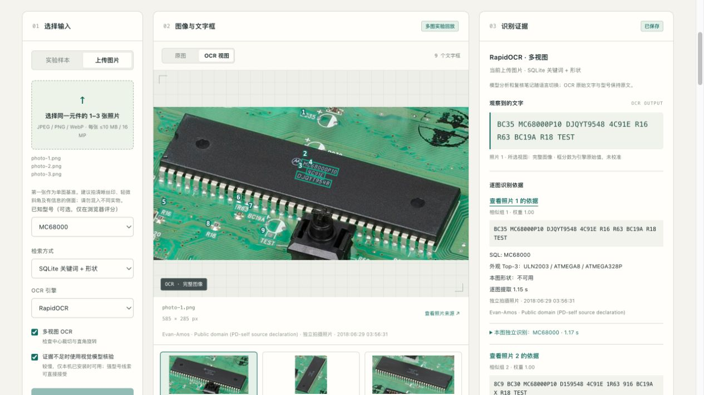
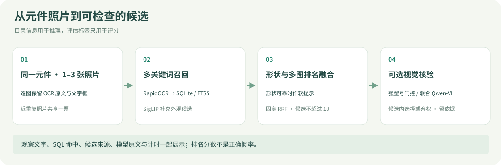
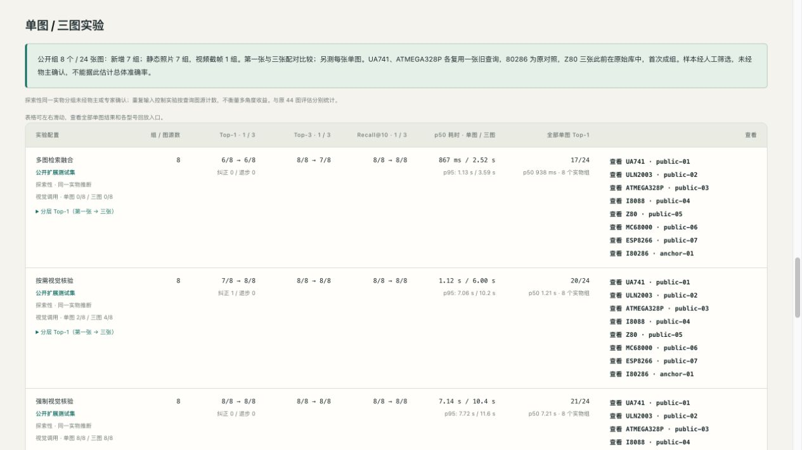
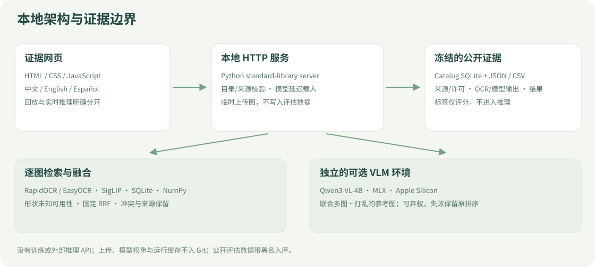

# PARTS / LAB · 元件识别工作台

**中文** · [English](README.en.md) · [文档索引](docs/README.md) · [实验与复现详解](docs/EXPERIMENTS_AND_REPRODUCTION.en.md)

从同一元件的 **1–3 张照片**，通过 OCR 多关键词检索目录，再结合外观、可靠时的形状和可选视觉模型排列候选。网页展示原始文字、命中字段、逐图依据、参考照片和耗时，让每一步都可检查。

这是公开照片与现成模型构建的本地研究演示：**18 类目录、44 张历史查询，以及 8 个同一实物假设的 24 个视图**。没有训练或微调；识别结果仍需人工核对。



*真实网页截图，回放已保存的公开实验，不是本轮新推理。照片：Evan-Amos，Public domain（PD-self来源声明）；[来源与配图说明](docs/assets/README.md)。*

## 先看网页，再运行模型

需要 Python **3.12**、[uv](https://docs.astral.sh/uv/)；Node.js 仅用于网页行为测试。私有仓库需要有访问权限的 GitHub 账号。

```bash
git clone https://github.com/HenryVarro666/parts-retrieval-demo.git
cd parts-retrieval-demo
uv sync --frozen --extra experiments
uv run --frozen --extra experiments python -I -m partsid.web --port 8765
```

打开 [本地工作台](http://127.0.0.1:8765/)。公开评估图片、目录 SQLite、已保存结果和译文缓存随仓库提供；**回放不需要下载模型权重**，但 `uv sync` 仍会安装项目依赖。首次实时识别按需下载固定模型；权重、环境和运行缓存不进入 Git。

- **实验样本**：浏览原 44 查询，筛选基线错误，切换保存的 OCR／SQLite／视觉实验，查看改善与退步。
- **单图／三图实验**：查看 8 组公开数据，点击型号回放，检查每图文字、照片来源和各自结果。
- **上传图片**：选择同一实物的 1–3 张 JPEG／PNG／WebP，每张最多 10 MB／16 MP。实时识别在本机临时文件中处理，不保存进评估数据。
- **语言切换**：中文／English／Español；界面、模型分析和复核笔记跟随切换。OCR 原文、型号、用户内容与实验数值保留。切换回放不重新推理；新实时分析的首次翻译可能调用本地可选 VLM 环境。

默认实时路径为 RapidOCR + SQLite + 外观补充 + 形状。视觉核验是可选项，需单独安装下述 Apple Silicon 环境；未勾选时不调用 VLM。可选“已知型号”只在浏览器评分，**不发送给推理**。

## 如何找到候选



| 证据 | 实际用途 | 边界 |
|---|---|---|
| OCR | 每图整图／中心裁剪各尝试四个直角方向，保留文字与框 | 这是单张图内的“多视图 OCR”，不是多张照片 |
| SQLite / FTS5 | 精确／字形容错别名优先，三元组支持部分错字，关键词检索厂商／描述 | 每次命中记录词、字段与规则；噪声／空文字可返回零候选 |
| SigLIP 外观 | 在数据库候选不足时补充；保留来源 | SQL 前5 + 外观前5去重补足至10，不把图像补充算作SQL命中 |
| 形状 | 可靠前景下的细长度、凸实度、圆度作软重排 | 不可靠时未知；不测真实尺寸、封装或引脚数 |
| 多图融合 | 固定 k=60 的 RRF，保护强型号并展示冲突 | 精确重复只提取一次；近重复组共享总票重，分数未经概率校准 |
| 可选 Qwen-VL | 联合查询照片＋打乱的参考图，在候选内选择或弃权 | 未召回的正确类无法由受限重排补救；模型解释也可能错读 |

“基线 Top-1”表示**原方法排名第一的型号是否正确**；Top-3 / Recall@10 表示正确类是否出现在前3／10候选。目录分数、RRF和OCR框分数都不是正确概率。

## 保存的结果：44 张查询

同一历史开发集，18 类，标签由模型生成、未获元件专家验收。当前规则和实验设计经过这批图的分析，不能视作独立盲测准确率。

| 方法 | Top-1 | Top-3 | Recall@10 |
|---|---:|---:|---:|
| 原 EasyOCR 三路基线 | 27/44（61.4%） | 33/44 | 43/44 |
| RapidOCR 单图内多视图 | 38/44（86.4%） | 40/44 | 42/44 |
| 仅 SQLite 多关键词 | 36/44（81.8%） | 36/44 | 36/44 |
| SQLite＋外观补充 | 38/44（86.4%） | 39/44 | 42/44 |
| 再加形状 | 38/44（86.4%） | 40/44 | 42/44 |
| 新候选＋每张视觉核验 | **42/44（95.5%）** | 42/44 | 42/44 |
| 强型号先接受，否则视觉核验 | 41/44（93.2%） | 42/44 | 42/44 |

形状只在 **10/44** 查询中可用。全量视觉剩余两错（UA741、ULN2003）都缺少正确 Top-10 候选。门控比全量视觉多错一例：OCR 错字可误命中另一合法别名。五路等票曾得到37/44，说明票数增加不保证改善。[完整阶段比较](results/candidates/comparison.md) · [早期组合比较](results/ensembles/comparison.md)。

44图视觉时间是分阶段实测合计，门控行是固定策略投影，均不能当作实时端到端请求延迟。44份新候选VLM响应曾实际生成；最终来源强化后的汇总复用了校验过指纹的44份缓存，不是重新生成44次。历史不同计时口径保留在[完整复现说明](docs/EXPERIMENTS_AND_REPRODUCTION.en.md)。

## 保存的结果：第一张与三张



8 个经筛选的实物假设，**7 组静态照片＋1 组视频视角**，没有物主或专家确认；24 视图不是24个独立实物。固定第一张作单图基准，没有按结果挑选最佳图片。

| 策略 | 单图 Top-1 → 三图 Top-1 | p50 单图 → 三图 |
|---|---|---|
| 检索融合 | 6/8 → 6/8 | 0.87 → 2.52 秒 |
| 按需视觉核验 | 7/8 → 8/8 | 1.12 → 6.00 秒 |
| 强制视觉核验 | 8/8 → 8/8 | 7.14 → 10.37 秒 |

增加照片单独没有改善 Top-1；检索 Top-3 还从8/8降到7/8。按需视觉纠正了一个 ATmega 错例，但强制单图视觉已为8/8。全部24张单独识别分别为17/24、20/24、21/24，这些结果仍按8个实物组聚类解释。

配对路径均重新提取查询证据，共享已加载检索模型，单图先执行；计入所调用VLM进程和加载，不计检索初始化、排队与网页翻译。时间在 M4 Pro 测得，存在顺序／缓存影响，不能外推到 RTX 5080。

24个来源拍摄中16个此前不在原209条库，8个复用来源（含两张原44查询及80286历史对照）；没有合成角度。输入已人工裁剪元件区域，未评估整板自动定位。[结果与限制](docs/research/2026-10-31-public-triplets-results.md) · [逐图来源／许可](data/public_triplets/README.md) · [操作指南](docs/MULTI_IMAGE_GUIDE.md)。

## 架构与可选模型环境



`partsid/web.py` 提供本地标准库 HTTP 服务；原始识别基线保留 identifier、BGE文字嵌入、SigLIP图像嵌入三路及RRF。新 SQLite 路径独立对照；图像向量搜索使用 NumPy，不是向量数据库。多图/来源/译文用 JSON/CSV 和指纹缓存保存。

可选视觉模型为 `mlx-community/Qwen3-VL-4B-Instruct-4bit`，隔离于基础环境，目前本地执行路径针对 **macOS Apple Silicon**：

```bash
uv venv .venv-vlm --python 3.12
uv pip install --python .venv-vlm/bin/python -r experiments/vlm-lock.txt
# 网页上传时勾选“证据不足时使用视觉模型核验”。
```

回放无需该环境。Linux/Windows 可回放保存的视觉结果；MLX视觉执行不因此变成CUDA兼容。PyTorch在Linux/Windows使用cu132索引，但RTX 5080运行仍未验证；不要将Mac结果当作GPU支持验收。具体固定revision、模型缓存与CLI重跑见[实验与复现](docs/EXPERIMENTS_AND_REPRODUCTION.en.md)。

## 复核与继续实验

```bash
uv run --frozen --extra experiments pytest -q
node --test tests/web_i18n.test.cjs tests/web_multi_image.test.cjs tests/web_app_multi.test.cjs
python3 scripts/readme_figures.py --check
```

[上次完整验证](docs/research/2026-10-31-public-triplets-verification.md)为178 Python＋16 Node测试及GitHub新克隆；[本次文档检查](docs/research/2026-10-31-bilingual-readmes.md)单列实际检查范围，没有重跑模型来宣称新准确率。重新实验请用新运行目录、保留旧结果；`multi_image_experiments report`会重写汇总，先保存并核对差异。

下一步优先：更多独立实物与专家型号核实、目录外/拒答测试、减少强别名误接受、提高正确候选召回。污损、失焦、反光、同封装与大目录仍未充分覆盖。多图、投票、更多参数或更大模型都不自动解决这些限制。

| 继续什么工作 | 入口 |
|---|---|
| 新机器运行与重测 | [完整运行说明](docs/EXPERIMENTS_AND_REPRODUCTION.en.md) · [多图指南](docs/MULTI_IMAGE_GUIDE.md) |
| 查问题、失败、改进 | [台账](docs/ISSUES_AND_IMPROVEMENTS.md) · [当前交接](docs/HANDOFF.md) · [保存规则](docs/DOCUMENTATION_WORKFLOW.md) |
| 找历史报告与设计 | [文档总目录](docs/README.md) |
| 更新 README 配图 | [图片来源／生成与截图方式](docs/assets/README.md) |
| 光伏三维／尺寸标定 | [独立2Dto3D仓库](https://github.com/HenryVarro666/2Dto3D) · [跨项目交接](docs/RECONSTRUCTION_HANDOFF.md) |

原始基线与标注由 Claude Code 于2026-10-30构建；后续OCR、SQLite、VLM、多图与三语实验分别留档。两个项目的识别准确率、点云质量与尺寸误差互不替代。仓库保持私有，图片按各自来源许可署名；公共评估数据入库，私人上传、模型权重和运行缓存不入库。
