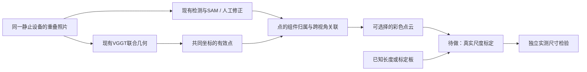

# 2D图片、点云与真实尺寸：研究接续

日期：2026-10-31。本文把用户贴出的早期点云建议接到实际工程状态；属于跨项目研究/交接记录，不是本轮新模型评测或新测量功能的完成声明。三维产品代码、照片及当前修复以独立的[2Dto3D仓库](https://github.com/HenryVarro666/2Dto3D)为准。

## 后续完成情况（2026-10-31，保留原调研正文）

三维私有main已经完成E04同4组修复复测，以及E05已知长度标定、原坐标两点测距和独立长度误差记录。参见[中英文README](https://github.com/HenryVarro666/2Dto3D)、[测量指南](https://github.com/HenryVarro666/2Dto3D/blob/main/docs/measurement/README.md)与[E05证据](https://github.com/HenryVarro666/2Dto3D/blob/main/docs/quality/2026-10-31-scale-measurement.md)。4组目标主机已合并，细线/分类仅部分改善，新增错误仍开放。

用户在异步回复中明确“暂时没有”实测尺寸。当前只有解析几何验证与旧真实GLB兼容性，不是现场尺寸精度。下文“待做”与“正在修复”描述此前快照，不替代上述当前工程状态；原研究与失败依据保留。原始GLB仍为unknown尺度，参考标定属于独立收据。

## 先纠正工程与版本

- 三维权威目录：`/Users/caochao/Documents/2Dto3D`；已实现V3的2–8图VGGT联合相机/深度、彩色点云、组件ID、逐图修正和GLB/PLY导出。[实际README](https://github.com/HenryVarro666/2Dto3D/blob/main/README.md)、[模型说明](https://github.com/HenryVarro666/2Dto3D/blob/main/docs/v3/models.md)。
- `/Users/caochao/Documents/ChatGPT/2Dto3D`是早期研究/教学工作区。它的元件检索报告保留的是升级前快照，不等于当前元件仓库或三维仓库的实现。
- 用户贴文所说“V2箱体＋下一步点云”适合作为早期构想；现在不能继续写作“点云还没做”。当前真正未完成的是稳定的实物组件关联、复杂细结构质量与有依据的真实尺寸。
- 本次核查的三维基线为`0522a85`。另一聊天正在`fix/v3-real-multiview-regressions`处理4组实拍的已知问题。本聊天只读核查，没有启动重复模型任务或改动该活动分支。

## 从2D到点云能做什么

边缘检测/轮廓只描述二维位置。三维点需要深度或多视角约束。对针孔相机，若有相机内参`fx, fy, cx, cy`和有效的相机轴向深度`z`，可以反投影：

`x=(u-cx)z/fx, y=(v-cy)z/fy, Z=z`。

再把像素RGB和同位置的组件掩码ID赋给点，就得到有颜色和组件归属的点云。需要保留裁剪、缩放、畸变和相机坐标到场景坐标的映射；点的颜色/分组并不会自动增加深度准确性。

当前V3已经采用**多图联合几何**，再用逐图掩码分配点；并非各图独立预测一张深度后直接叠加。官方VGGT支持从图像联合预测相机、深度等，具体工程仍需自己的几何和身份验收。[固定版VGGT说明](https://github.com/facebookresearch/vggt/blob/a288dd0f14786c93483e45524328726ab7b1b4ce/README.md)

单图模型一般只提供照片可见表面；隐藏的背面和接线不能被当作实际观测。多视角需要真实平移/视差、足够重叠及静止对象，不是重复同一照片或只在原地转相机。[COLMAP拍摄/重建说明](https://colmap.github.io/tutorial.html#structure-from-motion)

## 复杂结构是否更高效

表达弯曲线缆和不规则表面时，点云可以减少手写箱体/圆柱规则。但它增加几何推理、过滤、关联、传输及渲染成本；点越多也不代表更完整、更精确。应把“人工建模时间”“推理端到端时间”“查看器加载/FPS”和“结构质量”分开比较。

本项目已有4组/9张实拍诊断：各组V3 API时长约19.26–22.01秒，包含每组新的VGGT worker加载，不含浏览器载入，不能称完整网页暖态时间。更多可见表面被表达出来，但主机未正确跨图统一、细线断裂、遮挡背架未恢复。该批约3个实物假设、没有尺寸/扫描真值；任务`succeeded`和输出点数不能当精度验收。

原报告保存在三维本地工程：

`data/collections/sungrow/evaluation/runs/2026-10-31_v3_multiview_real_4groups/report.md`

例如Toyota细线有639个掩码网格位置，却只剩42个过滤后有效位置；因此先追踪分辨率、深度/置信过滤、重叠分配和体素各层的损失，再判断换模型或调过滤。单纯增大SAM只改善区域边界，不会修复错误深度或错误类别。

## 真实尺寸：分两条路线

| 条件 / 目标 | 可行路线 | 必须保留的限制 |
|---|---|---|
| 无参照单张照片 | 模型推测形状/可能的米制深度 | 尺度/相机和形状都有歧义，不能作为已验证真实尺寸 |
| 只测机柜同一平面的宽高 | 已知长宽的平面标定板，至少4个合适的非共线对应点，透视校正后测量 | 仅对该平面有效；畸变、角点和标定板尺寸误差仍需核对 |
| 测已有V3相对点云中的3D长度 | 把可定位的已知长度绑定到原始几何点，保存全局比例变换 | 单段只能约束尺度，不能修复局部非刚性形变、错深度或错相机 |
| 需要较可靠的复杂结构尺寸 | 多视角＋实测参照，或标定双目/RGB-D/扫描作为独立几何依据 | 反光/细线/遮挡仍需评估，必须有留出真值才能报告误差 |

同一平面校正依据见[OpenCV homography](https://docs.opencv.org/4.x/d9/dab/tutorial_homography.html)；已知标记与相机位姿可参考[OpenCV ArUco](https://docs.opencv.org/4.x/d5/dae/tutorial_aruco_detection.html)。只有尺子的两个端点通常不足以确定任意平面的完整透视变换；有已知长宽的标定板更便于建立完整平面对应。

对相对点云，设两点模型距离为`d_model`，实测参考长度为`L_mm`，则比例为`s_mm_per_unit=L_mm/d_model`。这一数学比例不是精度验证。至少另留2–3条没有参与校准的长度，比较预测与实测并记录绝对误差、相对误差、重复点选/拍摄波动；只在参与校准的那一条上对齐没有证明力。误差容限应按“看布局、安装间距还是加工制造”的用途另行确定。

当前三维API的`schemas.py`和`multiview_schemas.py`仍将`metric_scale_status`限定为`unknown`；没有可用的真实测距功能。未来实现需版本化保存参考点、原几何任务、实测长度/单位、变换、操作者证据与验证长度；点选和测量基于未分解的原始坐标，不能对爆炸图显示偏移测距。

## 模型候选核对：2026-10-31官方资料

| 候选 | 官方能力 / 环境证据 | 在本项目的地位 |
|---|---|---|
| 当前VGGT-1B | 联合多图几何；工程已用独立环境和固定权重 | 已接入，不为了做点云重新从单图搭一遍；领域质量仍需改善 |
| MoGe-2 | 可输出米制点/深度等，适合单图几何对照 | 研究候选，尚未实测本项目速度/精度；先核对兼容的独立依赖版本 |
| MoGe-3 | 官方当前安装说明明确不支持macOS，涉及FlexGEMM/Triton | M4不按最新main默认可跑规划；5080环境也须真实安装/显存验证 |
| Depth Anything V2 Small | 官方通用模型是相对深度，示例含MPS；米制模型是另一支 | 可作为Mac单图对照；输出显示灰度不能直接冒充真实z或毫米 |
| Depth Pro | 官方API返回米制深度和像素焦距 | 模型预测米制量仍需现场尺度及留出长度核验，不保证工程量测精度 |

来源：[MoGe](https://github.com/microsoft/MoGe)、[Depth Anything V2](https://github.com/DepthAnything/Depth-Anything-V2)、[其metric分支](https://github.com/DepthAnything/Depth-Anything-V2/tree/main/metric_depth)、[Depth Pro](https://github.com/apple-aiml-research/ml-depth-pro)。没有把官方示例/GPU延迟抄成本机结果。尤其MoGe当前main安装覆盖新版本依赖，不能只指定v2就假定macOS安装问题消失。模型源码/权重/许可及版本应在真正比较前固定。

## 建议的下一步顺序

1. **完成正在进行的4组回归修复。** 用原输入、原运行作对照，逐阶段审计细线点与组件关联；核查新增误合并/误检。先保留这一可复现基线。
2. **补人工确认与独立样本。** 每组记录是否同一物理设备、安装状态、视角、清晰区域和可见组件；早晚状态变化不能混进同一几何capture。
3. **做最小尺寸试验。** 先准备可以实际测量的对象/设备，优先同平面机柜宽高：核对标定板实物长宽＋畸变/透视处理＋留出实测长度；再扩展到相对点云全局尺度。现有公开照片没有尺寸真值，不能直接拿来验收误差。厂家目录尺寸只有型号和对应关系可靠时才能作为假定参照，必须标明“按目录尺寸假定”，不可同时冒充独立实测真值。该功能当前未实现。
4. **最后比较模型/分辨率和硬件。** 用相同留出输入比当前VGGT、需要的单图候选及224/336/518条件；分别测内存、冷/暖端到端、点分配质量、误合并和尺寸误差。没有真值时只报告诊断，不填准确率。

元件识别项目继续优先清晰OCR、候选召回与按需核验。点云可在未来补充封装/外形证据；不能在没有铭文、可靠尺度或授权型号资料时推出精确元件SKU，也不能让LLM把猜测尺寸变成测量值。

每次问题/尝试，包括失败和未完成项，按[文档保存约定](DOCUMENTATION_WORKFLOW.md)记录并链接回[台账](ISSUES_AND_IMPROVEMENTS.md)。三维活动分支的实际完成情况以其后续报告为准，本文不代替该聊天的修复或验收。
