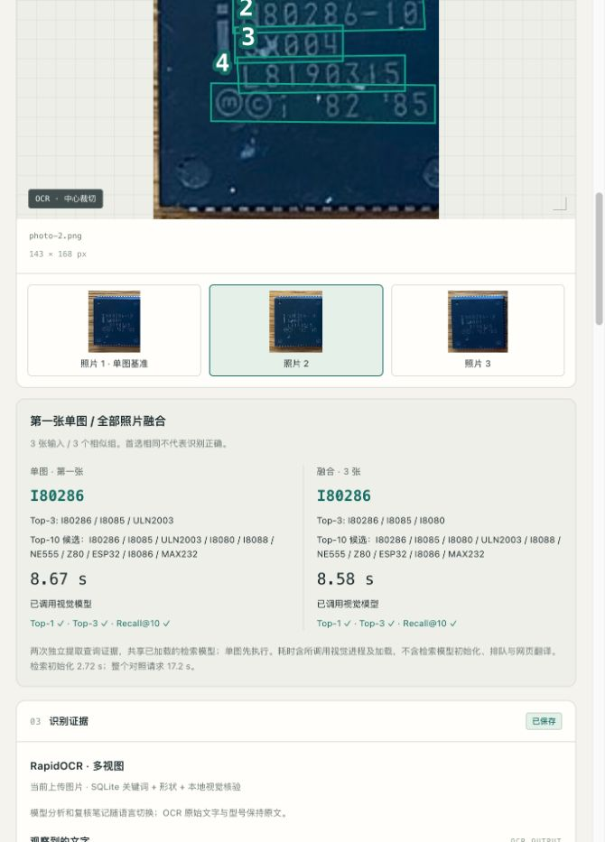
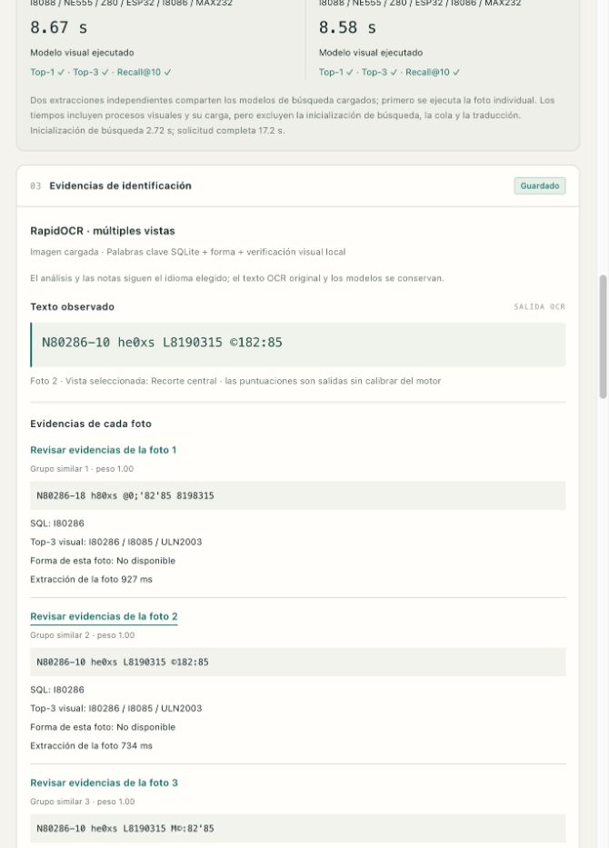

# 多图融合交付验证 — 2026-10-31

## 实现与实测

支持同一元件 1–3 图上传、逐图 OCR/框/数据库命中/外观候选/形状、重复与近重复分组、融合候选与逐图支持、可选联合视觉模型。中英西切换保留照片号、OCR 原文和型号。已知型号只在浏览器评分，不发送给推理服务。

检索模型为原有 RapidOCR + 固定 SigLIP，视觉模型沿用本机 `mlx-community/Qwen3-VL-4B-Instruct-4bit`，revision `2fd8dacbdb8f1e54b8c005f081ec5bf79c56376b`。未训练、调参、添加查询别名或调用云端模型 API。

| 对照 | 单图 | 三图 | 结果 |
|---|---:|---:|---|
| 44 查询图重复三次，检索/形状 Top-1 | 38/44 | 38/44 | 无改善、无退化；Top-3 40/44、Recall@10 42/44 均相同 |
| 上述重复控制 p50 / p95 | 817 / 1422 ms | 810 / 1305 ms | 重复图只提取一次，差异是运行波动；不代表多角度收益 |
| 80286 探索性实物组，检索融合 | 正确，1.04 s | 正确，1.97 s | 单图/三图 Top-1 均 I80286 |
| 同组，强制实际 VLM | 正确，8.67 s | 正确，8.58 s | 两次新生成，非缓存回放；含各自视觉子进程/加载 |

该实物假设仅一组，三张独立来源拍摄主要改变取景/大小，非物主/专家确认。三张裁剪的形状均不可用，未测得形状带来的增益。第一张 OCR 后缀误读为 `-18`，另两张读到 `-10`，但单图本已正确，没有 Top-1 增益。视觉模型仍把标记转写为 `N80286-1.0`，其解释不是专家事实。不能从一组单次结果宣称准确率或速度提升。

两条路径独立提取查询证据，共享已加载的检索模型，单图先运行。记录检索初始化和整个对照请求时间，单列逐图阶段及视觉进程时间。历史模型输出不用于实时缓存命中；模型、提示、全部视觉输入和来源像素均有指纹。单图先执行和系统暖缓存会影响耗时；一组实验的 p50/p95 就是同一个观测值。

## 软件验证

- 初始 147 Python tests；最终 **169 Python +15 Node tests** 通过，`git diff --check` 无问题。
- 测试覆盖互补证据、跨图强型号冲突、重复/近重复权重、候选上限、未知形状、联合输入指纹、候选外弃权、两条独立运行、强制实际视觉调用、输入原子性/上限/旧方式拒绝、来源哈希/照片顺序/标签/分组验证、三语和仅浏览器评分。
- 独立审查提出 5 项实质问题。每项先用行为测试复现失败，再修复；最终完整套件通过。无搁置问题。详细记录见 [审查及作者修复验证](2026-10-31-multi-image-code-review.md)。
- 结果回放把 `scope` 和分组绑定到已哈希的原始清单；三个裁剪不能伪装成三个来源拍摄，重复控制不能改个类别就成为确认的真实配对。
- 两个实测结果文档在审查后补充了其已哈希清单的显式路径，预测、OCR、VLM 原始输出和计时未改变，无重生成。

## 实际浏览器验证

- 本地页面一次选择三个 PNG，实际执行单图/三图；本次现场检索得到 I80286 / I80286，计时 1.20 s / 2.13 s，检索初始化 3.49 s，整个对照请求 6.98 s。这是网页冒烟验证，与上表冻结 CLI 计时分别保留。
- 切到照片 2，显示该图 OCR、`photo-2.png` 和 `0 0 143 168` 文字框几何；修复后标识符依据也随所选图更新，融合首选不变。
- 中文、英文、西班牙文切换保留照片号、OCR、候选和耗时，无重新识别；新保存模型分析的三语译文完整，原文可展开。
- 第四张被拒绝，已有三图和结果保留；额外用可控异步 FileReader 的完整页面消费者测试覆盖“读取过程中丢入非法批次”后的恢复。
- 新三图实验表独立于旧 44 图表，明确区分重复控制、探索性、已记录确认，以及按需/强制视觉策略；保存的联合视觉组可回放，无推理调用。
- 正常 670 px 页面，中英西无横向溢出（clientWidth = scrollWidth =670），浏览器警告/错误日志为空。

## 可复现性与保留

原有 249 个数据/结果文件与 `95923ed` 逐字节一致；原 354 条译文完整保留，新增 6 条，共 360 条。四条新模型翻译中一条西语术语经助手润色，保留原模型草稿。新增图像是三个明确记录父图/裁剪/作者/许可证的 PNG，原始 JPEG 不变。

新结果在 `results/multi_image/`，真实三图清单、来源验证、CLI 命令和采集建议见 [多图使用指南](../MULTI_IMAGE_GUIDE.md) 与 [data/ 核对](2026-10-31-multi-image-data-audit.md)。Git 不包含模型权重、环境和实时上传缓存；可回放保存的视觉判断。Apple Silicon 的实际联合 VLM 已运行；CUDA 联合 VLM 尚未实现/验证。
