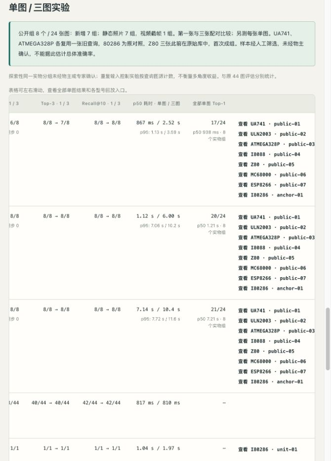
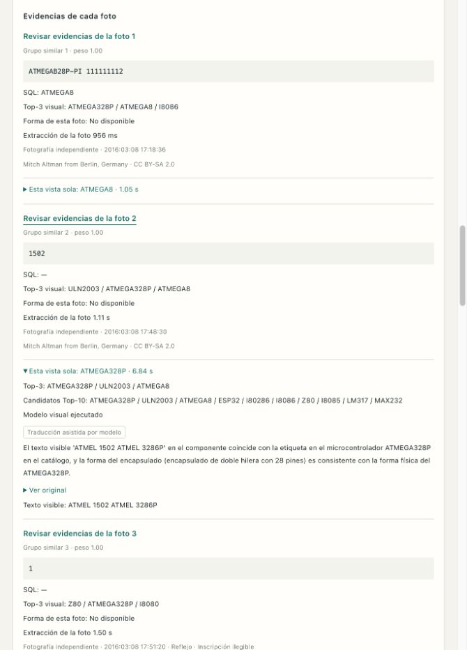

# 公开三图扩展交付验证 — 2026-10-31

## 数据与实测

- 冻结提交 `8f3e44d59172b0de7a42ae1104f208a42f365ce7` 在新批次推理前记录 8 组 /24 张目标裁剪；新增 7 组，保留 I80286 对照。后来未改选择文件、清单、照片、顺序、目录或推理规则。
- 7 个静态照片组 +1 个同一视频的真实视角组；全部仅为可见证据支持的同一实物假设。16 个来源拍摄在原209条原始库之外，其余复用情况逐图记录。并非全新盲测。
- 三种固定策略全部串行实测：检索 Top-1 **6/8 → 6/8**、按需视觉 **7/8 → 8/8**、强制视觉 **8/8 → 8/8**。每组第一张和三张独立提取，另测第2、3张完整单图。24张逐图结果分别 **17/24、20/24、21/24**，不能当作24个独立实物。
- 三图路径没有新增 Top-1 错误；检索 Top-3 有一组退步。全部实际 VLM 判断都没有复用历史判断缓存。含实际 VLM 进程/加载的时间、分层、逐组结论见 [实测分析](2026-10-31-public-triplets-results.md)。
- 源 JPEG/PNG 原样保存，模型输入是预先声明的整数目标裁剪；离线重建后与冻结文件逐字节一致。没有合成角度、标记叠字或图源说明进入推理。

## 软件与来源校验

- 最终本地完整套件 **178 Python tests +16 Node tests** 通过，`git diff --check` 无问题。
- 新行为测试先观察失败再修复：同一曝光的不同像素版本/文档ID/页面ID不能计作多次拍摄，目录拍摄排除，每张单图真实独立执行与回放顺序绑定，可选逐图测量不阻止普通报告生成，完整依赖哈希覆盖、改图后缓存失效、查询符号链接改向后缓存失效。
- 独立审查与复查覆盖全部24张裁剪、推理/GT边界、分母、来源许可抽查、报告兼容性和网页校验缓存。已发现的实质问题全部修复，详细证据见 [独立审查与接受](2026-10-31-public-triplets-code-review.md)。
- 因扩展后每次读取都解码验证来源，网页数据校验初次约2.64秒，之后约0.13秒。缓存仍逐次计算所有逻辑依赖的真实SHA256并绑定其解析后的目标；不依赖mtime或仅信任结果自行声明的哈希列表。独立复查也验证了“旧目标仍被其他输入引用”以及“验证过程中修改数据”的情况。
- `/api/image` 返回的 **24/24 PNG** 与冻结裁剪的RGB像素、尺寸完全一致；来源allowlist有效。页面保留44个旧查询、15个旧实验和6个多图实验（3旧+3新）。
- 对比原 `3855480`，**256 个既有数据/结果文件逐字节未变**；例外仅为增量译文及重算的多图报告两文件。原360条译文全部原样保留。

## 三语与浏览器

- 冻结保存分析为 **148 个原文 /444 条三语条目**，新增28个原文及84条；没有导出实时上传缓存。全部条目通过源文、提示、模型、语言及保护标记校验。
- 56条新中文/西文模型翻译中，两条因省略或重复保护标记在重试后仍被拒绝，助手修订并保留被拒绝的模型草稿；另25条做封装术语、混合语言语法或中文句法润色，也保留有效原草稿。没有改源分析、OCR或模型事实错误。
- 真浏览器在默认 **670px** 宽度验收中英西三语；clientWidth与scrollWidth均670，无页面横向溢出。宽表在容器内横向滚动，提供全部单图和各型号回放。
- 实际打开按需 ATMEGA328P：第一张选ATMEGA8且未调用VLM，三张选ATMEGA328P且实际调用，单组1.05s /10.5s；这个个案时间与批次p50分开。切到照片2后OCR原文为`1502`，来源为ArduTouch帧50；中英西切换保持所选照片、原文、候选和数值。
- 独立单图面板实际显示第二张ATMEGA328P /6.84s与第三张Z80 /6.23s，明确区别于整组三图结果。西语联合和独立分析可读，原文可展开。
- I8088来源显示ZMASLO /CC BY3.0及00:00:22.800、00:04:38.000、00:16:34.800，明确为同一视频；模糊/反光/遮挡标记和署名随所选视角显示。
- 浏览器警告/错误日志为空；回放与语言切换没有发起新识别。模型分析有真实误读/参考图混淆，页面明确提示对照原图核实。

## 运行边界

本机Apple M4 Pro实际执行了OCR、SQLite、SigLIP、形状与Qwen3-VL联合核验，没有训练、模型调参或云端模型API。模型权重、环境、候选研究暂存和实时上传缓存不在Git中；源图/许可、裁剪、代码、结果、译文和网页纳入版本控制。其他硬件/CUDA的实际质量与时间尚未验证。
